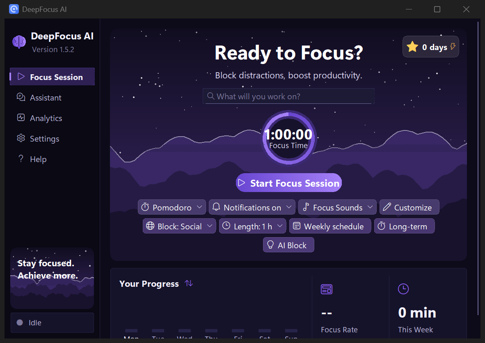
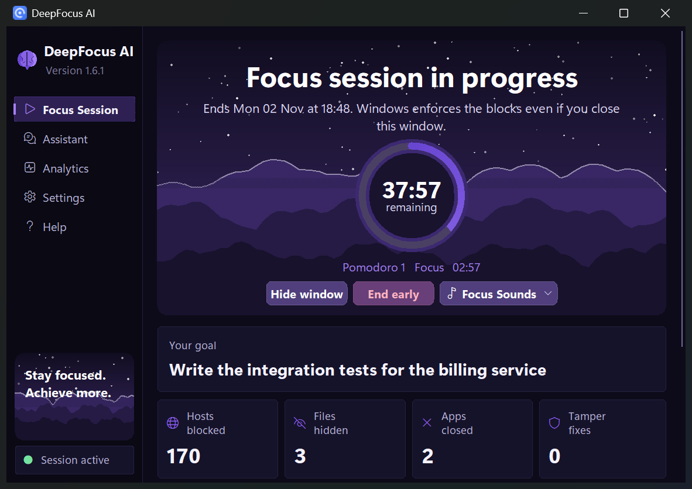
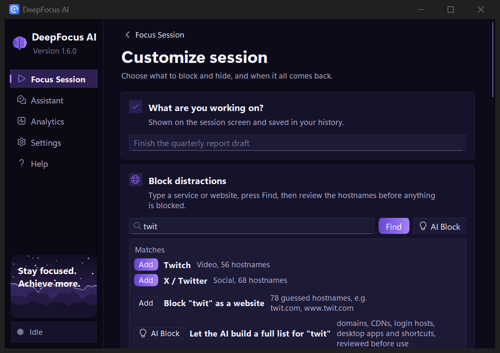
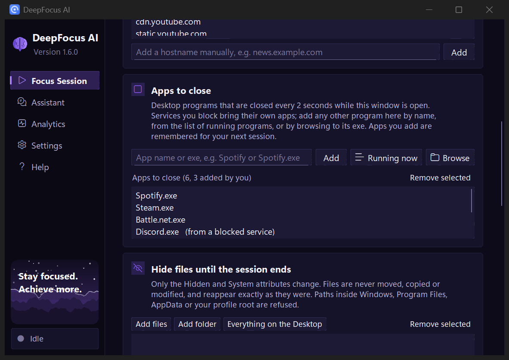
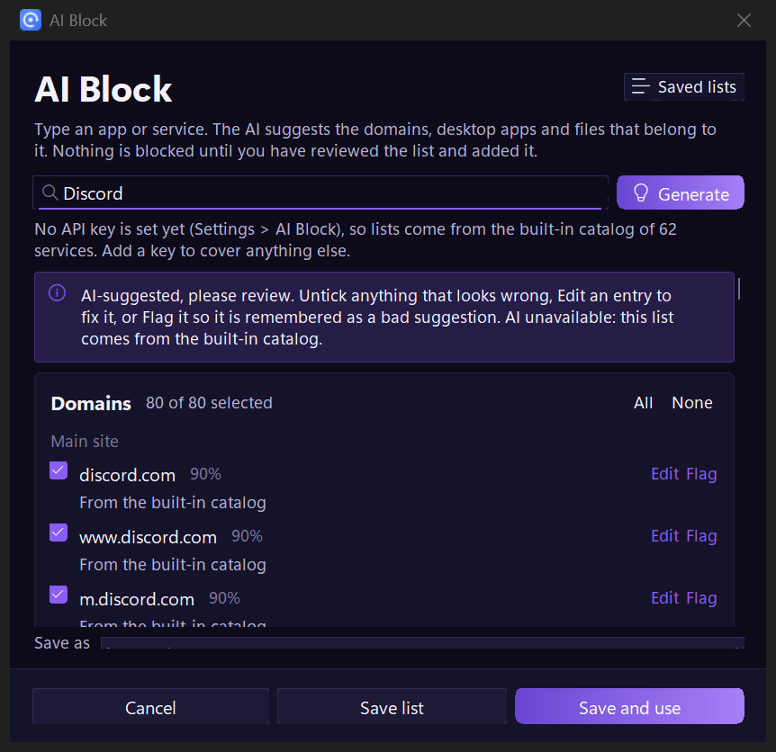
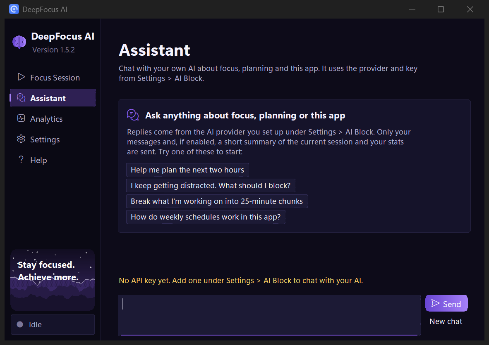

<p align="center">
  
</p>

<h1 align="center">DeepFocus AI</h1>

<p align="center">
  Block the sites, apps and files that pull you away. Set when they come back.<br>
  Windows restores everything on schedule, even if the app is closed, crashes, or the PC reboots.
</p>

<p align="center">
  <a href="https://github.com/youngfalconstone/DeepFocusAI/releases/latest"><b>Download for Windows</b></a>
  &nbsp;·&nbsp;
  <a href="#how-it-works">How it works</a>
  &nbsp;·&nbsp;
  <a href="#safety-design">Safety</a>
  &nbsp;·&nbsp;
  <a href="#run-from-source">Run from source</a>
</p>



## Download

**[Get the latest release](https://github.com/youngfalconstone/DeepFocusAI/releases/latest)** and download
`DeepFocusAI-<version>-win64.zip`. No installer, no dependencies, nothing to configure.

1. Unzip the archive anywhere, for example `C:\Program Files\DeepFocus` or a folder in your user profile.
2. Run `DeepFocus.exe`. Windows SmartScreen may warn because the app is not code-signed: choose **More info**, then
   **Run anyway**. The source is in this repository and the build is reproducible with `build\build.ps1`.
3. Pick what to block, set the length, press **Start**. A single administrator prompt appears when the session begins.

Requirements: Windows 10 or 11, 64-bit. The app keeps its state in `%USERPROFILE%\.deepfocus`.

**Undo at any time**: Settings > Emergency restore inside the app, or run the bundled `EmergencyRestore.cmd`.
To uninstall, end any running session, then delete the folder.

**Where to put it**: the scheduled tasks run the helper with administrator rights from wherever the exe lives. On a
PC shared with other accounts, or if you do not trust every program that runs under your own account, keep it in a
folder only administrators can write to, such as `C:\Program Files`. The default per-user location is fine for a
single-user PC.

## Screenshots

| Session running | Session builder |
|---|---|
|  |  |

| Apps to close | AI Block review |
|---|---|
|  |  |

| Assistant | |
|---|---|
|  | |

## What you get

- **Block by name.** A 62-service catalog (domains, CDNs, extra hostnames, desktop process names) across Video,
  Social, Gaming, News, Shopping and Music, plus direct hostname entry. Every list is shown for review before anything
  happens.
- **AI Block.** Type the name of an app or service and a language model proposes a complete block list grouped by
  purpose, with the desktop executables and shortcuts to hide. You review every entry with checkboxes, Edit and Flag;
  shared infrastructure and low-confidence guesses start unchecked; protected names are refused outright. Saved lists
  work exactly like built-in services. Bring your own key (Claude API by default, or any OpenAI-compatible endpoint);
  without one, the built-in catalog is used.
- **Assistant.** A chat page that talks to the same AI. Plan the afternoon, split a task into Pomodoro chunks, talk
  through a distraction. Replies stream in, Stop cancels, and an optional short session summary gives it context.
- **Add to a running session.** The session screen has "Add to block" (services or hostnames, applied through
  one administrator prompt and picked up by the enforcement task) and "Apps to close" (no prompt needed).
- **Three kinds of session.** A timer (minutes to hours, or an exact date and time), a long-term block (2 days to 3
  months) and a weekly schedule that stays blocked all week and lifts only in the free windows you pick per weekday,
  repeating for up to 52 weeks. Switching happens automatically within a minute, with the app closed.
- **Hide files** individually, by folder, or everything on the Desktop in one click, with an optional strict hide that
  denies reading until the session ends.
- **Close apps.** Services bring their own desktop processes, and you can add any app yourself: type its name,
  pick it from the list of running programs, or browse to the exe, in the session builder or from the running
  session's screen. Apps you add are remembered and already in place the next time you set up a session. Also: block Windows notifications, close browsers at start, Pomodoro reminders
  and ambient focus sounds.
- **Analytics**: total and daily focus time, completed vs early, streak, 14-day chart.
- **Presets**, dark and light themes, Windows accent colour, keyboard shortcuts for every page.

## How it works

| Step | Mechanism | Admin? |
|---|---|---|
| Block domains | Appends a marked block of `0.0.0.0` / `::1` lines to the hosts file after backing it up | Yes |
| Close the DoH bypass | Sets the Chrome, Edge, Brave and Firefox policies that turn DNS-over-HTTPS off, recording the previous values | Yes |
| Hide files | Sets Hidden + System on each chosen file or folder, recording the original bits. Nothing is moved or modified | No |
| Strict hide | Adds one read-deny permission entry per hidden file; removed at restore | No |
| Close apps | While the window is open, closes chosen processes every 2 seconds | No |
| Scheduled restore | Registers "DeepFocus AI Restore": time trigger, logon trigger, run if missed, wake the computer | Yes |
| Enforcement | Registers "DeepFocus AI Enforce", which runs every minute: re-applies anything undone by hand, switches weekly free windows on and off, and restores once the session has expired | Yes |

The app itself never runs elevated. It lists exactly what it needs on the Review screen, then launches
`DeepFocus.exe helper apply` through one UAC prompt. Task Scheduler, not the app, ends the session.

## Safety design

- **Independent restore.** A crash, a closed window or a reboot cannot leave anything blocked: the restore task
  fires at the end time, and the enforcement task restores as well once the time has passed.
- **Idempotent, defensive restore.** Any DeepFocus block found in the hosts file is removed even if the session
  record is missing. Lines outside the two marker comments are never touched.
- **Exact restore.** Original file attribute bits, DoH policy values and the notifications switch are recorded and
  put back exactly.
- **Path guard.** Paths inside Windows, Program Files, ProgramData, AppData, the profile root, the Desktop folder
  itself, the hosts file, the app folder and the state folder are refused, by the GUI and again by the helper. Paths
  that are, or lie under, a symbolic link or junction are refused too.
- **The helper trusts nothing.** It re-validates the plan (session id, restore time, list shapes and sizes, option
  types, every hostname and path) and refuses a plan outside the state folder or behind a link. The same applies
  to "Add to block": the request must name the running session, and only valid, unprotected hostnames and
  program names are merged, with the hosts file backed up before the rewrite. Recorded file paths
  go through the guard again at restore time, DoH restore only writes the five known policy values, and system tools
  are run from `System32` by absolute path, so an edited state file cannot point the elevated helper anywhere else.
- **Protected names.** Hostnames that would break Windows or sign-in (localhost, microsoft.com, google.com, ...) are
  never written.
- **Hosts backups** before every change (newest 20), atomic writes that preserve the file's bytes and line endings.
- **AI features.** Only the typed name (AI Block) or your messages plus an optional short summary (Assistant) leave
  the machine. Endpoints must be https, responses and history are size-capped, model text is sanitised before it
  reaches the screen, and the key lives only in the Windows Credential Manager.
- **Cooling-off.** Ending early needs a countdown (default 30 s); strict mode also requires typing a phrase.

What is not protected: anyone with administrator rights can still stop a session by deleting the tasks and editing
the hosts file. This is a focus aid for you, not a parental control.

## Setting up the AI features (optional)

Open **Settings > AI Block**, choose Claude API or an OpenAI-compatible endpoint, paste your key and press **Test**.
The key is stored in the Windows Credential Manager and never written to settings, logs or history. **Remove** deletes
it. Both AI Block and the Assistant use this configuration; everything else in the app works without it.

## Run from source

Plain Python 3.12+ with tkinter, no third-party packages.

```
git clone https://github.com/youngfalconstone/DeepFocusAI.git
cd DeepFocusAI
pythonw -m deepfocus
```

Build the exe and Start Menu / Desktop shortcuts (needs `pip install pyinstaller`):

```
powershell -ExecutionPolicy Bypass -File build\build.ps1
```

Tests (no admin needed; each suite isolates itself from your real state folder and hosts file):

```
python -m tests.test_core
python -m tests.test_aiblock
python -m tests.test_helper_sandbox
python -m tests.smoke_gui
```

## Known limits

- The hosts file blocks exact hostnames and cannot wildcard. Sites and apps stop loading and signing in, but a
  service that streams from random subdomains may keep delivering an already-open stream.
- Browsers read the DoH policy when they start. An already-open browser keeps its old setting until restarted, or use
  "Close all browsers when the session starts".
- Desktop-app closing only runs while the window is open.
- Weekly switches happen on the enforcement task's next minute, so they can be up to a minute late.
- Strict hide uses a permission entry; OneDrive may report sync errors for locked files until restore.
- AI Block suggestions are only as good as the model's knowledge. Review every list.

<details>
<summary><b>Project layout</b></summary>

```
deepfocus/
  __main__.py   entry: GUI, or `helper ...` for the elevated worker
  app.py        tkinter application (pages, dialogs)
  ui.py         theme tokens and the widget kit
  catalog.py    services, presets, hostname expansion; saved AI lists as "ai:<slug>" services
  aiblock.py    AI Block: schema, prompt, validation, protected and broad lists, offline fallback
  llm.py        provider-agnostic JSON completion and streaming chat over urllib
  credstore.py  API keys in the Windows Credential Manager
  schedule.py   one-shot, long-term and weekly schedules
  hostsfile.py  build / strip / verify the marked hosts block
  filehide.py   attribute-based hide / exact restore, optional ACL lock
  guard.py      refuses paths that must never be hidden
  doh.py        browser DNS-over-HTTPS policies with exact restore
  notif.py      Windows notifications switch with exact restore
  sounds.py     generated ambient focus sounds
  state.py      session, history, settings, presets (atomic JSON), log rotation
  helper.py     elevated worker: apply / restore / enforce / status, Task Scheduler XML
  elevate.py    UAC launch of the helper and result hand-off
  procwatch.py  background process closer
  notify.py     Windows toast notifications
build/          PyInstaller spec, version resource, icon generator, build script
tests/          core, AI Block (mock server), helper sandbox (real Task Scheduler), GUI smoke, screenshot capture
docs/           screenshots
```

</details>
